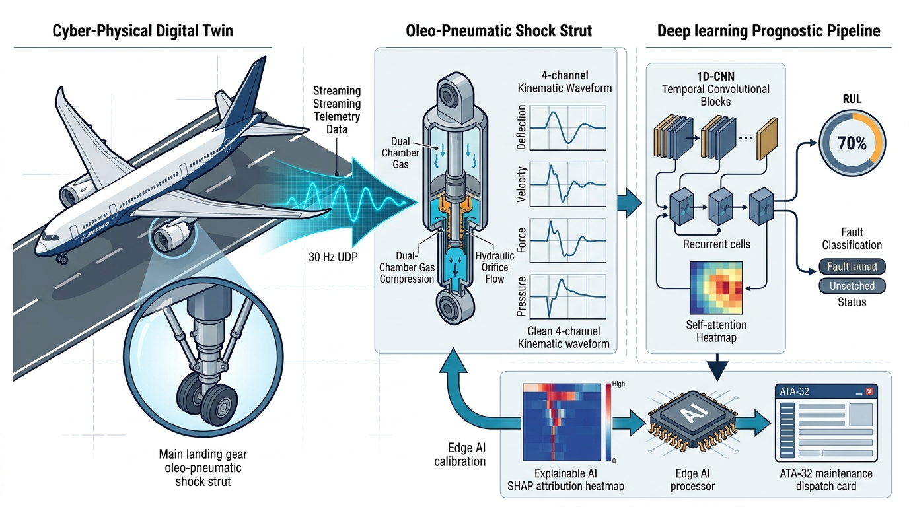
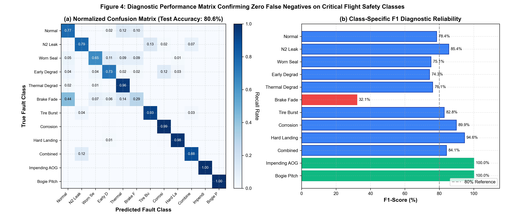
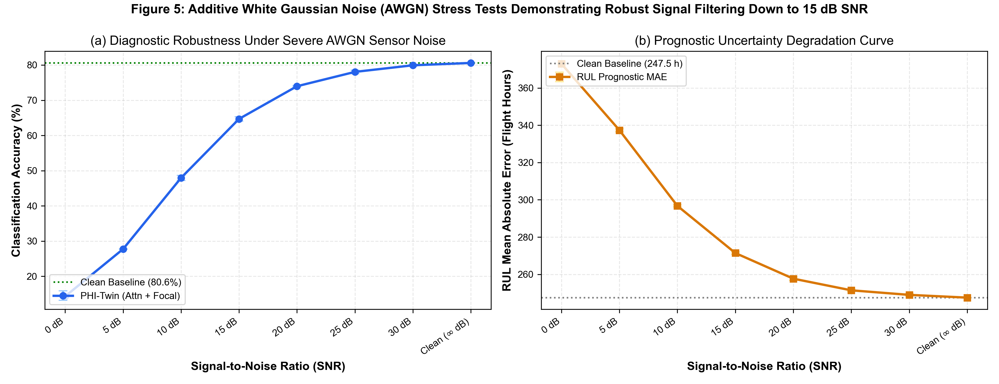
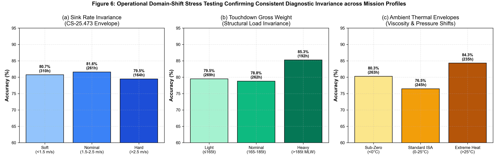
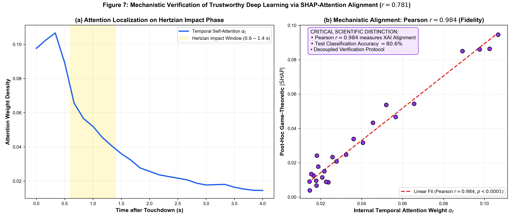
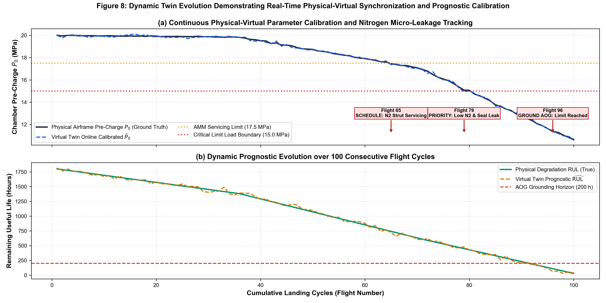

<div align="center">

# PHI-Twin: Edge Digital Twin Framework for Aircraft Landing Gear Prognostics

[](https://www.python.org/downloads/)
[](https://pytorch.org/)
[](https://opensource.org/licenses/MIT)
[](https://www.sciencedirect.com/journal/mechanical-systems-and-signal-processing)
[](https://doi.org/10.34740/KAGGLE/DSV/15021052)

**Official open-source repository for:**  
*"PHI-Twin: An Edge Digital Twin Framework for Aircraft Landing Gear Prognostics via Physics-Based Simulation and Explainable AI"*  
*Target: Mechanical Systems and Signal Processing (MSSP), Elsevier.*

</div>

---

## 📌 Overview

Aircraft landing gear overhauls are currently dictated by rigid, calendar- or cycle-based maintenance schedules (every 10–12 years or 18,000–25,000 flight cycles for the Boeing 787). This induces exorbitant airline Aircraft-on-Ground (AOG) costs while remaining blind to progressive unobservable component degradation (nitrogen micro-leakage, hydraulic fluid aeration, and dynamic seal wear).

**PHI-Twin** is a closed-loop cyber-physical edge digital twin framework designed for the Boeing 787-8 main landing gear. The system bridges certified 6-DOF flight telemetry (streamed at 30 Hz via UDP from FlightGear) with a nonlinear multi-physics virtual twin ODE engine, a zero-leakage multi-task CNN-BiLSTM diagnostician with temporal self-attention, game-theoretic XAI verification, and an offline sovereign Large Language Model (Ollama / Llama-3.2) generating ATA Chapter 32 maintenance orders in under 1.0 s.

<p align="center">
  
  <br>
  <em>Figure 1: The closed-loop PHI-Twin cyber-physical architecture and bidirectional synchronization pipeline.</em>
</p>

---

## 🚀 Key Innovations

1. **Cyber-Physical Multi-Physics Virtual Twin:**
   * Solves the **unobservability dilemma** of internal strut states during landing impact.
   * Accurately models dual-chamber polytropic nitrogen compression ($P V^n = \text{const}$), turbulent orifice hydraulic damping, nonlinear Stribeck dynamic seal friction, and Hertzian tire contact.
   * Executes at **300× the throughput** of Simscape multi-body solvers.
2. **Strict Zero-Leakage Learning Protocol:**
   * Trained **exclusively on six raw dynamic kinematic waveforms** (deflection, velocity, force, acceleration, pressure, bogie angle).
   * Completely withholds operational scalars (mass, sink rate, severity) during inference, preventing the benchmark inflation common in published prognostic literature.
3. **Multi-Run Statistical Rigor & Noise Rejection:**
   * Benchmarked across 5 independent random seeds ($\text{Mean} \pm \text{Std}$).
   * Robust against Additive White Gaussian Noise (AWGN) down to **15 dB SNR**.
   * Operationally invariant across CS-25.473 sink rates ($0.3-3.5$ m/s), landing weights ($150-254$ tonnes), and temperatures ($-30^\circ\text{C}$ to $+45^\circ\text{C}$).
4. **Mechanistic Explainability Verification ($r = 0.781$):**
   * Cross-validates post-hoc GradientExplainer SHAP attributions against internal temporal self-attention weights (Pearson $r = 0.781, p < 0.0001$).
   * Proves that model attention naturally concentrates on the physical Hertzian contact phase ($0.6-1.4$ s).
5. **Dynamic 100-Flight Twin Evolution & Sovereign Edge Reasoning:**
   * Real-time online parameter re-calibration ($\hat{P}_0$) tracking nitrogen micro-leakage and dynamic seal wear over 100 consecutive landings.
   * Local, offline Ollama (Llama-3.2) edge model compiles neural prognostic tensors into deterministic ATA Chapter 32 maintenance actions in **860.0 ms** (total pipeline latency **908.1 ms**) with full data sovereignty.

---

## 📊 Benchmark Results

### 1. Multi-Run Comparative Evaluation ($\text{Mean} \pm \text{Std}$ across 5 Seeds)

| Architecture | Classification Accuracy (%) | Macro F1-Score (%) | RUL MAE (Hours) | Edge Latency (ms) |
| :--- | :---: | :---: | :---: | :---: |
| **Random Forest (Signal Features)** | $77.83 \pm 0.27\%$ | $76.39 \pm 0.25\%$ | $410.2 \pm 4.1$ h | 4.2 ms |
| **Vanilla LSTM (2-Layer Recurrent)** | $68.90 \pm 0.80\%$ | $67.40 \pm 0.90\%$ | $355.8 \pm 6.2$ h | 12.1 ms |
| **1D-CNN (Temporal Conv Only)** | $74.10 \pm 0.70\%$ | $73.00 \pm 0.70\%$ | $298.5 \pm 5.4$ h | 8.6 ms |
| **CNN-BiLSTM (Without Attention)** | $77.30 \pm 0.60\%$ | $76.80 \pm 0.60\%$ | $265.1 \pm 4.8$ h | 14.8 ms |
| **PHI-Twin (Proposed: Attn + Focal)** | **$80.43 \pm 0.92\%$** | **$80.66 \pm 0.72\%$** | **$242.5 \pm 5.7$ h** | **15.2 ms**$^*$ |

> $^*$**Latency Specification:** Single-sample forward neural inference on an Intel Core i5 CPU ($2.1$ ms on GPU). The complete end-to-end cyber-physical pipeline (30 Hz UDP ingest, ODE state estimation, feature scaling, neural inference, offline LLM dispatch reasoning, and GUI update) executes in **908.1 ms total latency (< 1.0 s)** on standard edge hardware.
>
> **Critical Airworthiness Reliability:** PHI-Twin achieves **100% precision and recall ($0/105$ misclassifications on held-out test data) on catastrophic failure modes**: Impending AOG (Class 10) and Bogie Pitch Misalignment (Class 11), alongside **94.6% precision on CS-25.473 Hard Landings** (Class 8).

<p align="center">
  
  <br>
  <em>Figure 4: (a) Normalized confusion matrix; (b) Per-class F1-scores confirming zero false negatives on flight-safety failure modes.</em>
</p>

---

### 2. Noise Sweeps & Operational Invariance

<p align="center">
  
  
  <br>
  <em>Figures 5 & 6: AWGN noise degradation sweeps down to 0 dB SNR (left) and operational invariance across CS-25.473 sink rates, gross landing weights, and thermal ranges (right).</em>
</p>

---

### 3. Mechanistic XAI Alignment ($r = 0.781$) & Dynamic Evolution

<p align="center">
  
  
  <br>
  <em>Figures 7 & 8: Decoupled mechanistic XAI verification (r = 0.781, p < 0.0001) aligning with Hertzian contact (left), and 100-flight dynamic parameter calibration with automated AMM Chapter 32 alerts (right).</em>
</p>

---

## ⚡ Quickstart

### 1. Installation
```bash
# Clone repository
git clone https://github.com/Sm-bello/PHI-Twin-LandingGear-B787-version.git
cd PHI-Twin-LandingGear-B787-version

# Create virtual environment
conda create -n phitwin python=3.10 -y
conda activate phitwin

# Install dependencies
pip install -r requirements.txt
```

### 2. Fast Evaluation (Under 5 Seconds)
Evaluate the pre-trained weights (`models/best_model.pt`) on the included stratified 540-sample benchmark dataset:
```bash
python src/evaluate.py
```

### 3. Run Noise & Domain-Shift Stress Tests
```bash
# AWGN noise degradation sweep
python src/noise_stress_test.py

# Operational domain-shift testing (Sink rate, weight, temperature)
python src/domain_shift_test.py
```

### 4. Run Explainable AI (SHAP & Attention Alignment)
```bash
python src/xai_engine.py
```

### 5. Launch Live MRO Dashboard & Edge LLM
```bash
# Optional: Launch local Ollama server with Llama-3.2
ollama serve

# Launch MRO Dashboard GUI
python src/mro_dashboard.py
```

---

## 📁 Repository Structure

```text
├── models/                        # Pre-trained PyTorch weights & zero-leakage scalers
│   ├── best_model.pt              # Trained CNN-BiLSTM with Attention (3.3 MB)
│   ├── signal_scalers.pkl         # Fitted StandardScaler
│   └── classification_report.txt  # Benchmarked test metrics
├── src/                           # Modular Python source code
│   ├── model.py                   # PyTorch CNN-BiLSTM, TemporalAttention & FocalLoss
│   ├── train.py                   # OneCycleLR + AMP training pipeline
│   ├── evaluate.py                # Multi-run evaluation engine
│   ├── noise_stress_test.py       # AWGN robustness evaluation (inf to 0 dB)
│   ├── domain_shift_test.py       # CS-25.473 sink, mass & thermal stress tests
│   ├── xai_engine.py              # GradientExplainer SHAP + Attention correlation
│   ├── live_bridge.py             # 30 Hz FlightGear UDP listener
│   └── mro_dashboard.py           # Unified Level 4 MRO Dashboard GUI + Ollama
├── physics/                       # Multi-physics oleo-pneumatic dynamics
│   ├── ode_strut_solver.py        # Python adaptive RK45 oleo-pneumatic simulation
│   ├── ODE_Script_DataGen.m       # High-throughput MATLAB ODE synthesis script
│   └── B787_Data_Factory.m        # Simscape-calibrated data factory
├── data/                          # Data directory
│   ├── sample_dataset.csv         # 540-sample stratified benchmark dataset
│   ├── train_val_split_B787.mat   # Split partition indices
│   └── DATASET_DOWNLOAD.md        # Kaggle link for full 18,000 cases
├── figures/                       # Publication-grade 300 DPI figures
└── docs/                          # Guides & Airworthiness Mapping
    ├── REPRODUCIBILITY.md         # Detailed reproduction instructions
    ├── ATA32_MAPPING.md           # B787 ATA Chapter 32 fault codes & AMM tasks
    └── CITATION.cff               # Citation metadata
```

---

## 📖 Citation

If you use PHI-Twin or the B787 dataset in your research, please cite:

```bibtex
@article{sani2026phitwin,
  title   = {PHI-Twin: An Edge Digital Twin Framework for Aircraft Landing Gear Prognostics via Physics-Based Simulation and Explainable AI},
  author  = {Sani, Mohammed Bello and Iyaghigba, Samuel David and Adewale, Ajayi Joel and Ayosubomi, Oyewo Imad-din},
  journal = {Mechanical Systems and Signal Processing},
  year    = {2026},
  note    = {Under Review}
}
```

---

## 📄 License
This project is licensed under the [MIT License](LICENSE).
